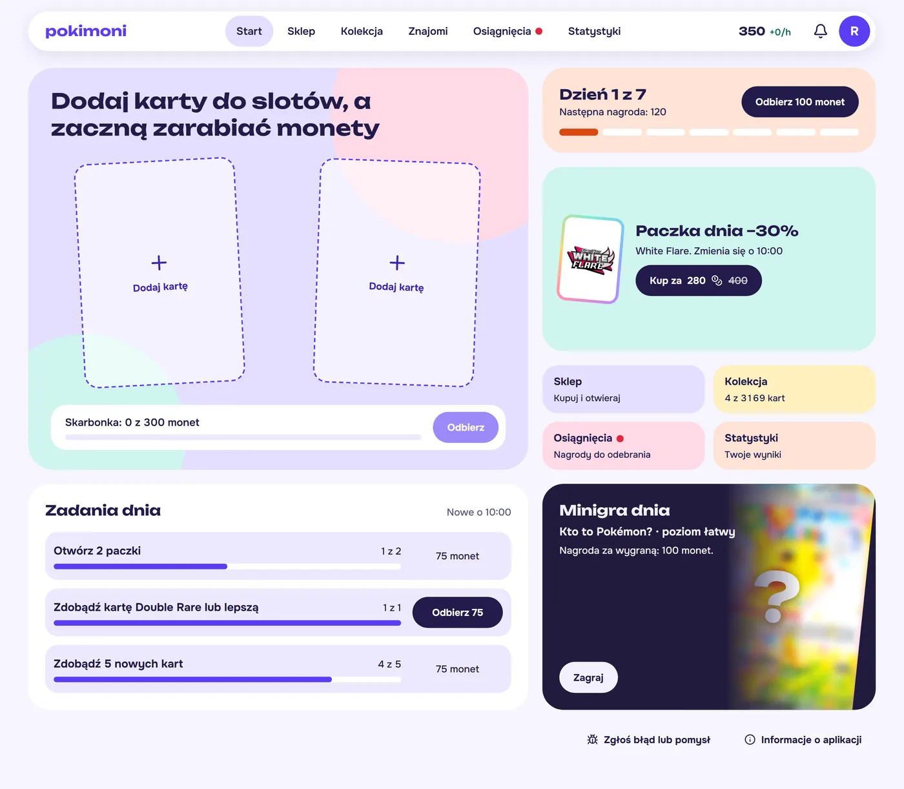
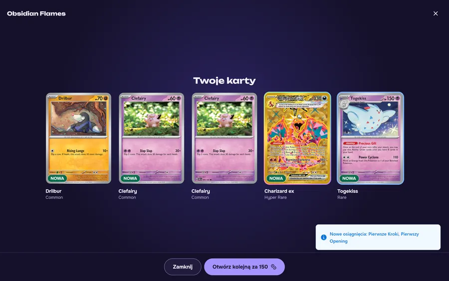
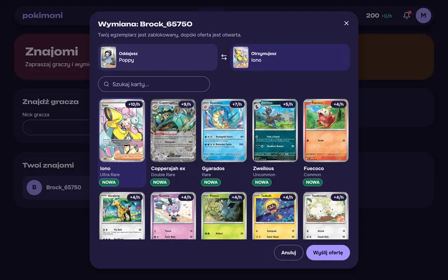
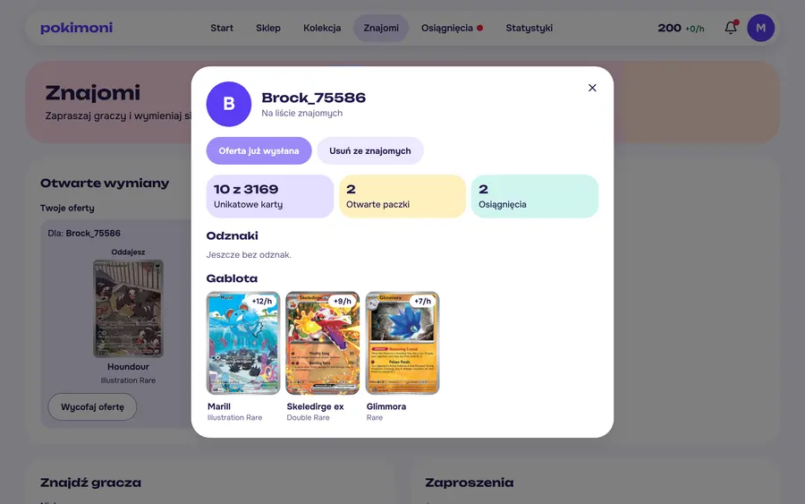
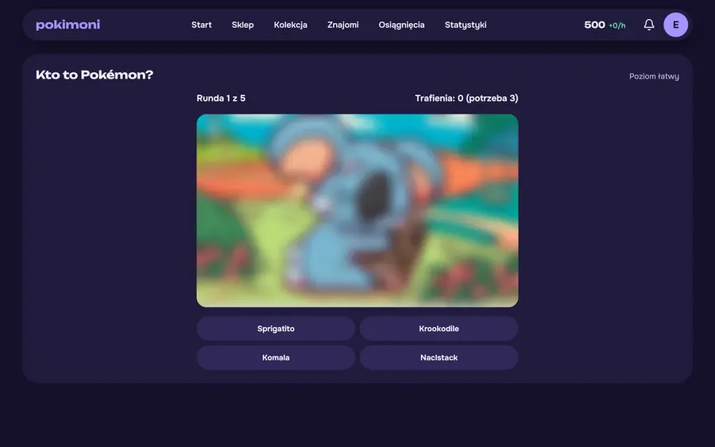

# Pokimoni

A collectible card game in the browser: open packs, build a collection of 3,169 real cards, earn coins from the cards you own and trade with friends. Built as a portfolio project and played with friends.

**Live:** https://pokimoni.vercel.app/ (the interface is in Polish)



|                                                                                    |                                                                                     |
| ---------------------------------------------------------------------------------- | ----------------------------------------------------------------------------------- |
|                    |            |
|  |  |

## Features

- **Pack opening:** tear the pack, reveal cards one by one, then review all five. Three pack tiers with their own drop rates, and a discounted daily pack.
- **Income:** two slots hold cards that earn coins per hour into a capped piggy bank.
- **Daily activities:** a seven-day streak reward, three solo quests and one minigame a day, rotating through three games and three difficulties.
- **Social:** friend invitations by nick, one-to-one card trades, public profiles with a card showcase, and an inbox available from every page.
- **Progress:** 34 achievements with rewards, badges, statistics and a per-set collection index with filters.
- **Interface:** a custom design system with light, dark and system themes, loading placeholders and keyboard support. Works from 360 px up.

## Stack

Next.js 16 (App Router), React 19, TypeScript, Tailwind CSS 4, Radix UI, TanStack Query, Drizzle ORM, PostgreSQL (Supabase), `jose`, `sharp`, Vitest, Playwright, axe, Vercel.

## Architecture

```
src/
  domain/      Pure game rules: draws, economy, quests, minigames. No I/O, random numbers are injected.
  server/      Services (one transaction per operation), authentication, database.
  app/api/     Thin route handlers: authenticate, validate, call a service.
  features/    Client state and queries, by feature.
  components/  Interface.
```

The dependency direction is one way: `domain` knows nothing about the rest, and the interface only imports types from the server.

Decisions worth a look:

- **The server decides everything.** The client never sends a price, a draw or a result, and the user id comes only from the session token. Memory and "who is it" views contain only what the rules have revealed, so reading the network traffic does not help.
- **Minigame pictures are made on the server.** The client gets an image without metadata and never sees the card's address, because the address would give away the answer.
- **Every change to a player's coins or cards takes that player's row lock first,** always in the same order, which rules out double spending and deadlocks. The database also enforces the balance and copy limits with constraints.
- **Own session tokens:** signed JWT in an `HttpOnly` cookie, with a token version that invalidates sessions after a password change. Row-level security is on, and only the server reaches the database.
- **Content Security Policy without nonces.** Nonces would force every page to render on each request and lose the static shell behind the fast first paint, so Next's inline scripts need `'unsafe-inline'`. The app renders no raw HTML, and the policy still blocks foreign scripts, framing, form targets and other hosts.
- **A game day starts at 10:00 Polish time** and follows daylight saving, computed in one pure function.

## Tests

| Command            | What it runs                                                                                                           |
| ------------------ | ---------------------------------------------------------------------------------------------------------------------- |
| `npm test`         | Unit tests of the rules and integration tests of services and API routes on PGlite (Postgres in WebAssembly)           |
| `npm run test:e2e` | Playwright on desktop and a phone, against a production build and PGlite, with axe accessibility checks in both themes |

`tests/helpers/economy-simulation.ts` plays simulated players through the real rules and the real catalog, for months of game time, to check that the economy holds its targets. CI runs formatting, lint, types, both test suites and the build on every push.

PGlite has a single connection, so race tests run one after another: they prove that one of two claims wins, but not how row locks behave on a real server.

## Running locally

Requires Node 22 and a PostgreSQL database.

```bash
npm ci
cp .env.example .env.local   # then fill in SESSION_SECRET and DATABASE_URL
npm run db:migrate           # applies migrations to DATABASE_URL
npm run db:seed              # loads the card catalog
npm run dev
```

Tests need no database or secrets of your own:

```bash
npm test
npm run build && npm run test:e2e
```

## Documentation

The `AUDIT/` folder (in Polish) records how the project was rebuilt: the audit of the original code, the product specification, the target architecture and a log of every phase with its decisions and measurements.

## Credits

Card data and images come from the [Pokémon TCG API](https://pokemontcg.io/). Pokimoni is a non-commercial fan project and is not affiliated with, endorsed by or sponsored by Nintendo, The Pokémon Company, Game Freak or Creatures. Pokémon and all related names and images are trademarks of their respective owners.
